# Wovenleaf

A local-first book tracker, ebook reader, and audiobook player for iOS and Android.
Built with React, TypeScript, Capacitor, and SQLite, with a quiet, paper-inspired interface.

Free and open source. No account, subscriptions, or library limits.

<p align="center">
  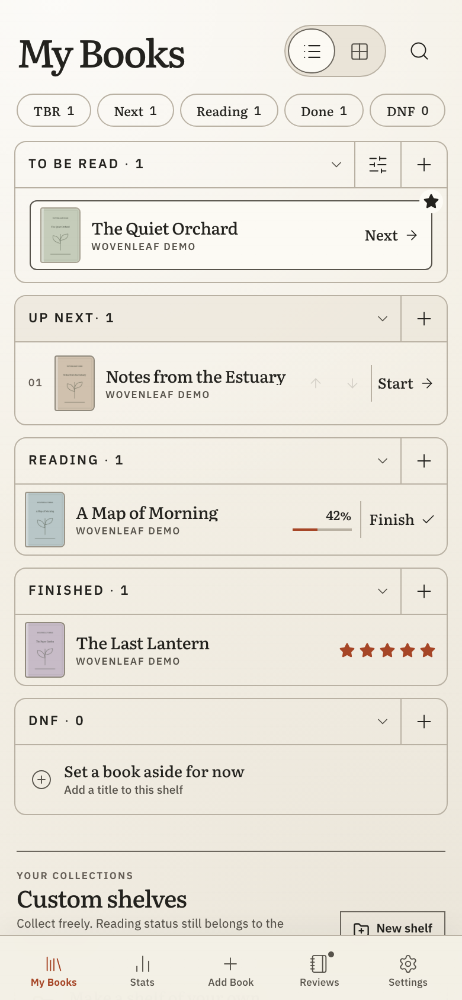
  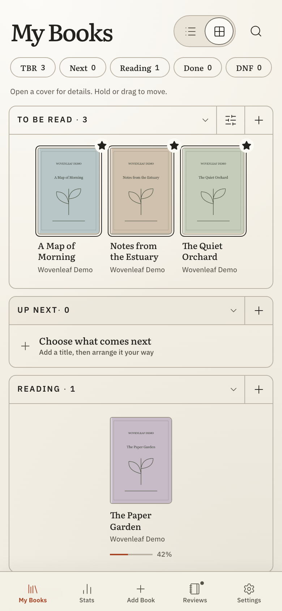
  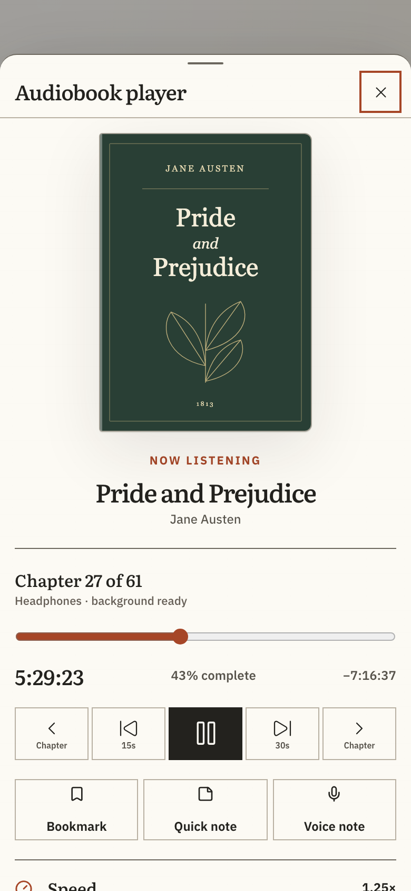
</p>

<p align="center"><sub>Library · Cover grid · Audiobook player</sub></p>

<p align="center">
  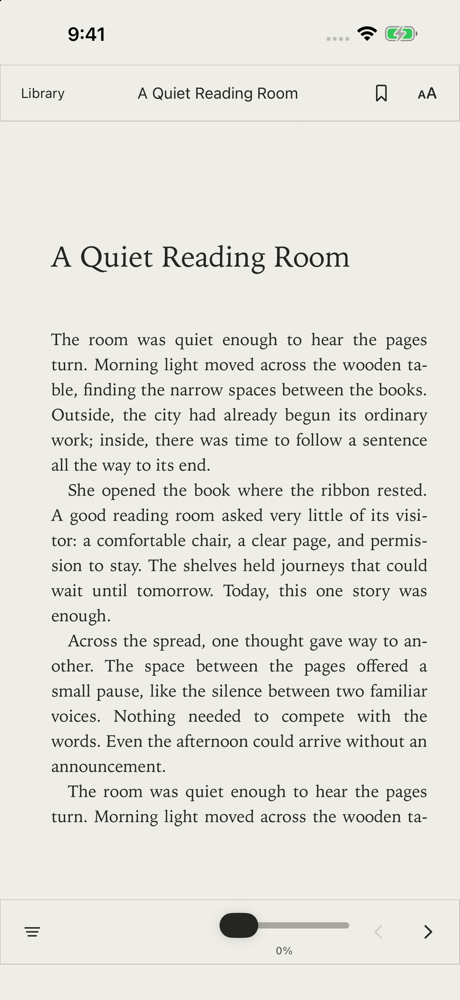
  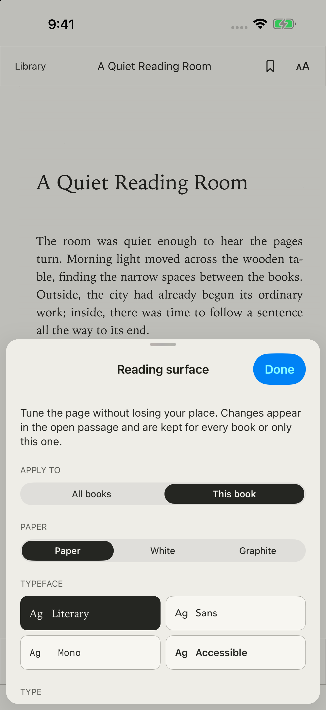
  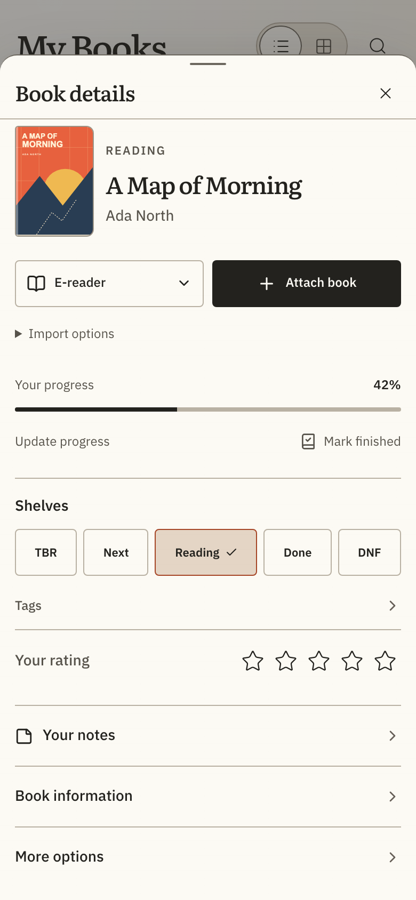
</p>

<p align="center"><sub>Reading · Reading appearance · Book details</sub></p>

Demo library covers are original [CC0 artwork](docs/screenshots/covers/README.md).

<p align="center">
  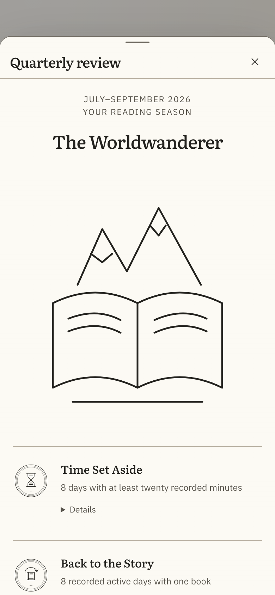
  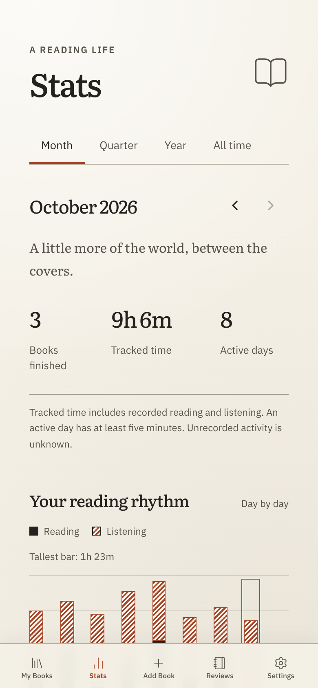
  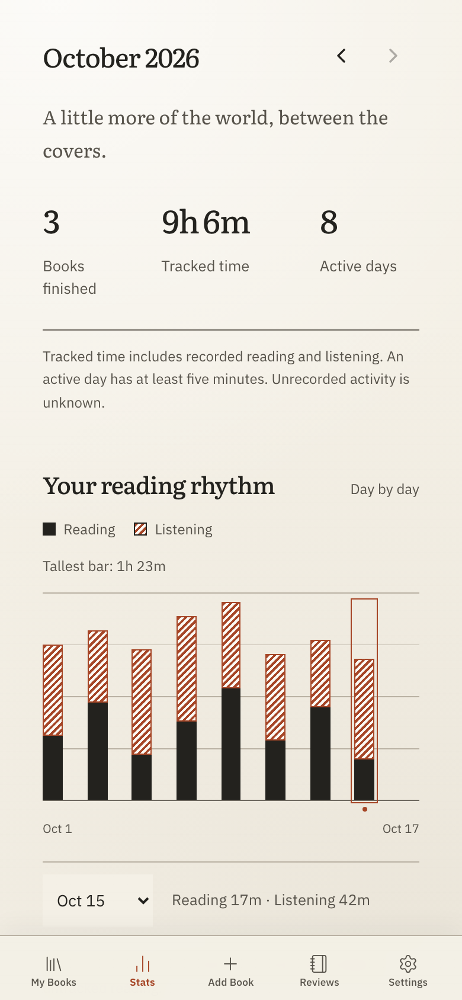
</p>

<p align="center"><sub>Quarterly review · Reading stats · Reading rhythm</sub></p>

These screenshots use fictional reading history and the same original demo covers.

## Features

- **Your library:** reading shelves, custom collections, personal tags, ratings, notes, and local search.
- **Add books:** manual entry, ISBN scanning, optional Open Library lookup, and previewable Goodreads/CSV imports.
- **Read and listen:** DRM-free EPUB/PDF reading and local audiobook playback with chapters, bookmarks, playback speed, and a sleep timer.
- **Track progress:** reading history, statistics, and saved quarterly reviews.
- **Libby companion:** import loans and receive reading/listening progress from Libby on the web.
- **Keep your data:** local storage, portable exports, and backup/restore.
- **Make it yours:** paper and night themes, adjustable text size, and English, Spanish, French, German, and Italian.

You supply your own book and audio files. Online metadata and integrations are optional.
Native reading, playback, and integration capabilities differ from the browser preview.

## Getting started

Requires [Bun](https://bun.sh) **1.3.13**. From a fresh clone:

```sh
git clone https://github.com/hmrguez/wovenleaf.git
cd wovenleaf/apps/mobile
bun install --frozen-lockfile
bun run dev
```

Open the local URL printed by Vite. No API keys or environment variables are required
for the core app.

For native builds, install Android Studio/SDK 36 and JDK 21, or macOS and Xcode for iOS:

```sh
# From apps/mobile
bun run android:open
# or
bun run ios:open
```

See [Build and install](docs/guides/community-builds.md) for APK installation,
iOS signing, and browser limitations.

## Libby setup

<p align="center">
  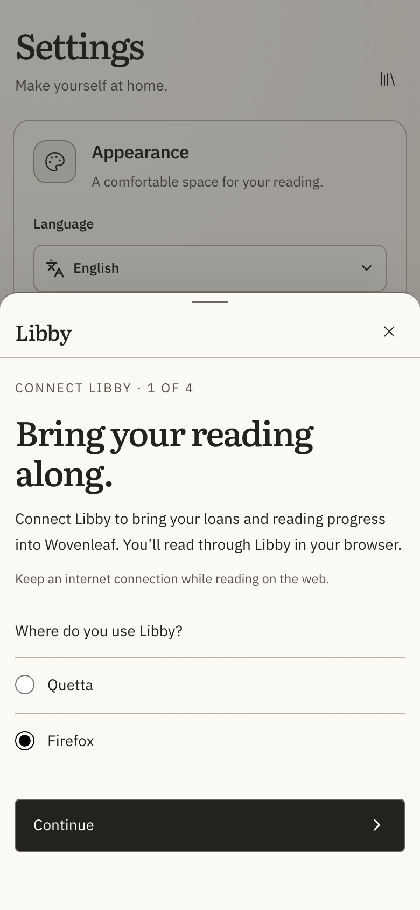
  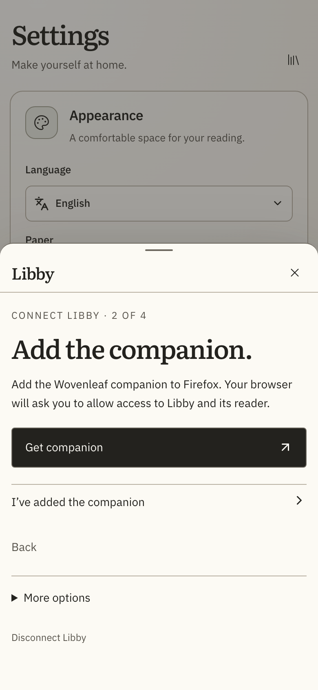
</p>

The optional companion receives loan details and progress from **Libby on the web**.
It does not monitor the native Libby app. Wovenleaf never asks for your library card or Libby password.

1. Open **Settings → Libby** in Wovenleaf and enable the integration.
2. Choose **Quetta or Firefox on Android**, or enable the bundled **Wovenleaf Libby** extension in **Settings → Apps → Safari → Extensions** on iOS.
3. Install/enable the companion and allow access to Libby and its reader. For Android development builds, use **More options → Use a connection code instead**, then enter it in the companion’s **Connection help** and select **Connect & enable capture**.
4. Open or refresh your Libby web **Shelf**, then return to Wovenleaf to verify the connection. Read or listen in that browser to receive subsequent progress.

Visit the Shelf again after a browser restart or if captures stop. Existing-book matches
and conflicting progress appear for review; updates can be undone and links disconnected.
Android code-free pairing and physical Safari verification remain release gates.

### Companion build and configuration

```sh
# From the repository root, after installing mobile dependencies
node apps/libby-extension/build.mjs
```

Outputs Chromium, Firefox, and Safari packages under `apps/libby-extension/dist/`.
The mobile `dev` and `build` scripts also build the companion automatically.
For Chromium development, load `dist/chromium` unpacked; Quetta supports the generated
ZIP through its developer extension installer. Firefox Android distribution requires a signed add-on.

Optional build variables in `apps/mobile/.env.local`:

| Variable | Purpose |
| --- | --- |
| `VITE_LIBBY_EXTENSION_STORE_URL` | Published Chrome Web Store or Edge Add-ons listing for Quetta. Unset by default; setup shows the listing as unavailable. |
| `VITE_LIBBY_FIREFOX_STORE_URL` | Override the default Wovenleaf Libby Progress listing on Mozilla Add-ons. |

Use genuine HTTPS listing URLs. Safari needs matching app/extension signing and App Group
entitlements. See the [companion guide](apps/libby-extension/README.md) for packaging,
installation, and verification details. Wovenleaf is independent of Libby and OverDrive.

## Development

From `apps/mobile`:

```sh
bun run lint
bun run typecheck
bun run test
bun run build
```

| Directory | Contents |
| --- | --- |
| `apps/mobile/` | React app, SQLite storage, and native iOS/Android projects |
| `apps/landing/` | Astro marketing website; install dependencies and run `bun run dev` separately |
| `apps/libby-extension/` | Libby browser companion |
| `docs/` | Build guides, integrations, and architecture decisions |
| `third_party/` | Dependency licenses and notices |

See the [developer guides](docs/development/README.md) for building, debugging, signing,
and packaging your own releases. Contributions welcome: see [CONTRIBUTING.md](CONTRIBUTING.md).
Report vulnerabilities as described in [SECURITY.md](SECURITY.md).

## Privacy

Your library and imported files stay on your device. ISBN scanning processes camera
frames locally. Optional online lookup sends search terms or ISBNs to Open Library;
remote covers and integrations contact their providers. Export backups regularly,
especially when using browser storage.

## License

[MIT](LICENSE) for original code and project-owned artwork, except the [CC0 demo covers](docs/screenshots/covers/README.md). Third-party components
retain their [own licenses and notices](third_party/README.md).
